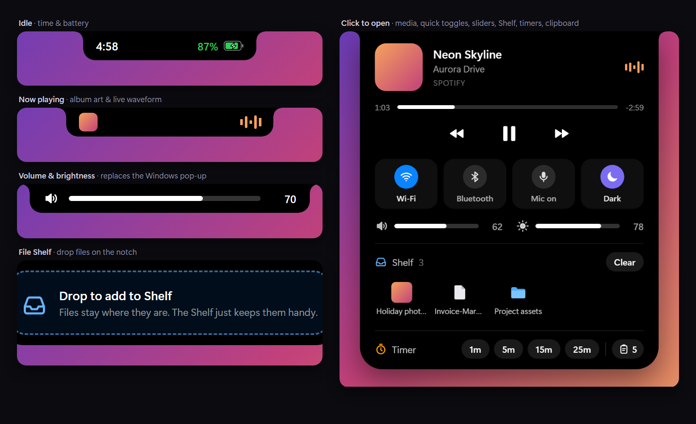
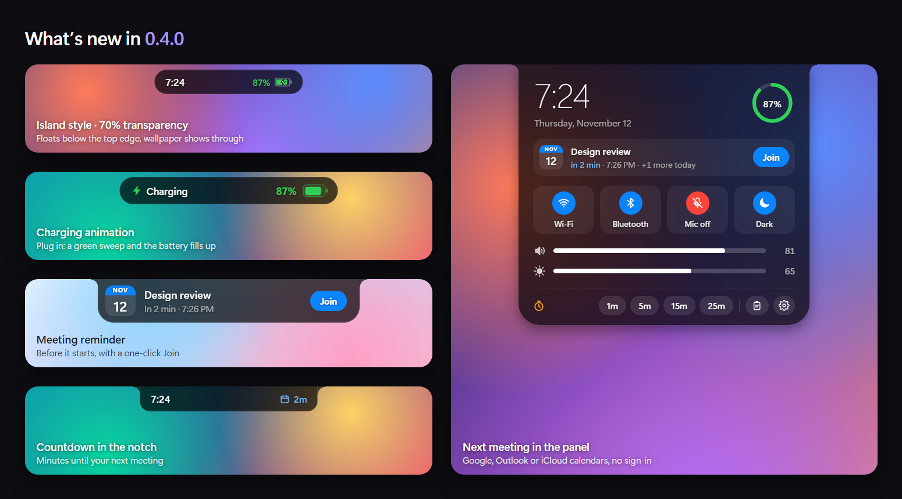
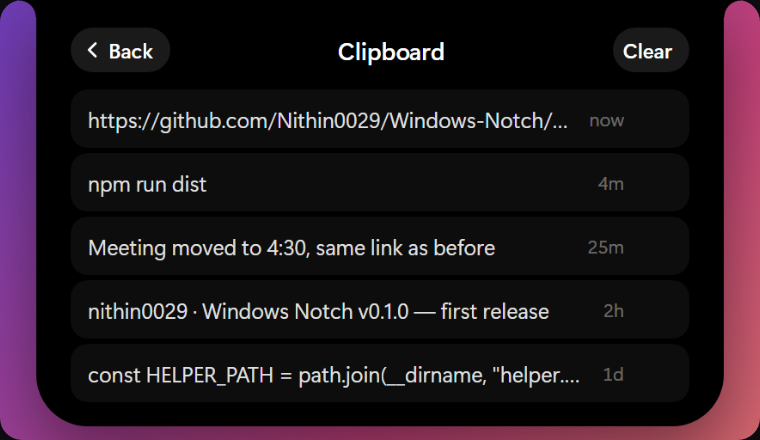
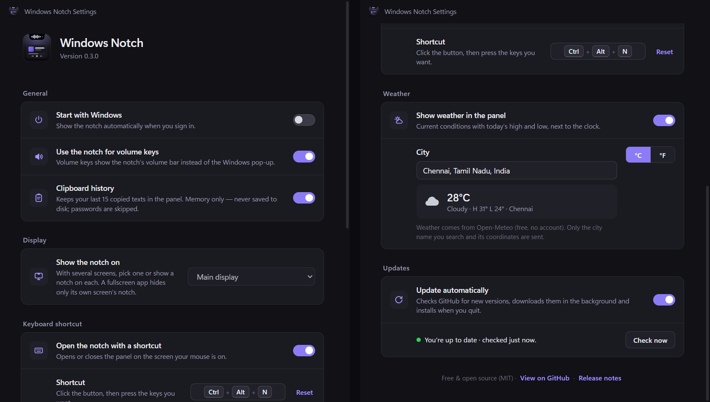
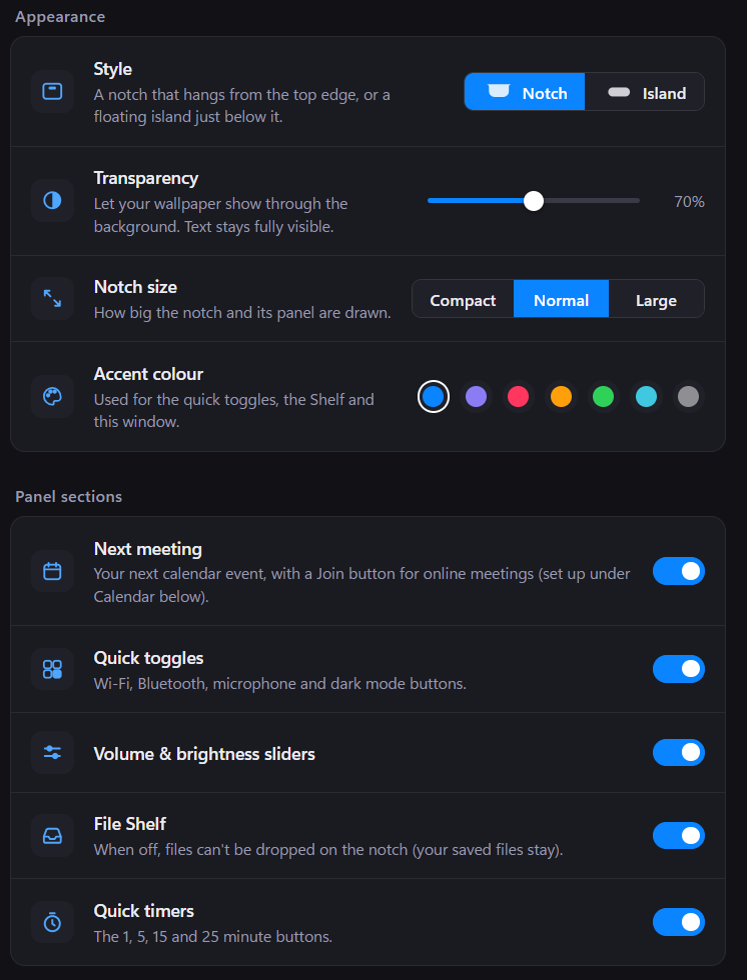
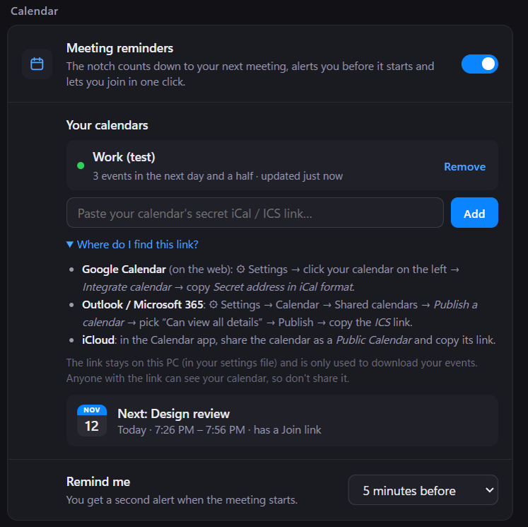

# Windows-Notch

A MacBook-style **notch** for Windows. It sits at the top centre of your screen, shows what's going on, and gets out of the way when it isn't needed.



## Features



- **The notch itself:** sits flush with the top edge of the screen, with curved "shoulders" and smooth animations as it grows and shrinks.
- **Idle:** time on the left, battery on the right (green while charging, red when low).
- **Now playing:** album art and a waveform tinted to match the cover. Works with Spotify, YouTube in Chrome or Edge, Media Player, and anything else that uses Windows media controls.
- **Volume and brightness bar:** the notch widens to show the level whenever volume or brightness changes. Scroll over the notch to change the volume.
- **Volume keys:** the notch takes over your keyboard's volume keys, so the Windows volume pop-up no longer appears. The keys go back to Windows while a fullscreen app is in front.
- **File Shelf:** drag files or folders from File Explorer onto the notch to park them there. Open the panel to find them again:
  - drag a file out to drop it into any app
  - double-click to open it
  - right-click to show it in its folder
  - × to remove it

  Files are never moved or copied; the Shelf only remembers where they are.
- **Quick toggles:** one-click **Wi‑Fi**, **Bluetooth**, **microphone mute** and **dark/light mode**, right in the panel.
- **Weather:** current conditions with today's high and low, next to the clock. Pick your city in Settings.
- **Meeting reminders:** add your Google, Outlook or iCloud calendar with its private iCal (ICS) link; no sign-in needed.
  - the notch counts down the minutes to your next meeting
  - an alert shows before it starts (1–15 minutes, you choose) and again when it starts
  - **Join** opens the Google Meet, Teams, Zoom or Webex link in one click
  - the panel shows what's next, or what's on now
- **Charging animation:** plug in the charger and the notch widens, a green light sweeps across it and its battery fills up. It also tells you when the battery is fully charged.
- **Clipboard history:** your last 15 copied texts. Click one to copy it again.
  - It's kept in memory only, never saved to disk.
  - Passwords that password managers mark as private are skipped.

  
- **Privacy dots:** an orange dot shows while an app uses the microphone, a green dot while it uses the camera, and a short alert names the app.
- **Alerts:** track changes, charger plugged in or unplugged, fully charged, low battery, meeting coming up, timer finished, update ready.
- **Keyboard shortcut:** **Ctrl + Alt + N** opens the panel on the screen your mouse is on. You can change it in Settings.
- **Multiple monitors:** show the notch on your main screen, on every screen, or on one you choose. A fullscreen app hides only its own screen's notch.
- **Auto-update:** new versions download in the background from GitHub Releases and install the next time the app quits.
- **Make it yours:**
  - two styles: a **notch** that hangs from the top edge, or a floating **island** just below it
  - **transparency** from 40% to 100%, so your wallpaper shows through
  - three sizes (Compact, Normal, Large)
  - seven accent colours
  - choose which panel sections appear: next meeting, quick toggles, sliders, Shelf, timers
- **Panel (click the notch; move the pointer away or click the notch again to close it):**
  - media controls with a progress bar, or a big clock, the date, the weather and a battery ring when nothing is playing
  - your next meeting, with Join
  - quick toggles
  - volume and brightness sliders
  - your Shelf
  - quick timers (1, 5, 15, 25 minutes), clipboard history and ⚙ Settings
- **Stays out of the way:** the window is shaped to the notch itself, so everything around it stays clickable.

## Settings

Open Settings in any of these ways:
- with the ⚙ button in the panel
- by clicking the tray icon
- by launching **Windows Notch** again from the Start menu



<p>
  
  
</p>

| Section | Options |
|---|---|
| **General** | Start with Windows, use the notch for volume keys, clipboard history, charging animation |
| **Appearance** | Style (Notch / Island), transparency, size (Compact / Normal / Large), accent colour |
| **Panel sections** | Show or hide next meeting, quick toggles, volume & brightness sliders, File Shelf, quick timers |
| **Display** | Main display, all displays, or a specific display |
| **Keyboard shortcut** | On/off, plus a recorder to choose your own keys |
| **Weather** | On/off, city search, °C / °F |
| **Calendar** | Meeting reminders on/off, add or remove calendars (up to 5), remind me 1 / 2 / 5 / 10 / 15 minutes before |
| **Updates** | Update automatically, Check now, Restart & update |

Weather comes from [Open-Meteo](https://open-meteo.com/) (free, no account). Only the city name you search for and that city's coordinates are sent.

### Adding your calendar

Copy your calendar's private iCal (ICS) link and paste it into **Settings → Calendar**:
- **Google Calendar** (on the web): ⚙ Settings → click your calendar on the left → *Integrate calendar* → *Secret address in iCal format*
- **Outlook / Microsoft 365**: ⚙ Settings → Calendar → Shared calendars → *Publish a calendar* → choose *Can view all details* → Publish → copy the *ICS* link
- **iCloud**: share the calendar as a *Public Calendar* and copy its link

The link is stored only in your local settings file and is used only to download your events, every 15 minutes. Anyone who has the link can read that calendar, so don't share it. Google and Outlook let you reset it at any time.

## Download

1. Get the latest **`Windows-Notch-Setup-x.y.z.exe`** from the [Releases page](https://github.com/Nithin0029/Windows-Notch/releases).
2. Run it. It installs for your user only (no admin needed) and starts the notch straight away. From then on it updates itself.

The notch starts with Windows automatically; you can change that in Settings. To uninstall, go to **Windows Settings → Apps → Installed apps → Windows Notch**.

> **"Windows protected your PC"?** The installer isn't code-signed (that costs money), so SmartScreen warns about it the first time. Click **More info → Run anyway**.

> **Coming from 0.1.0 or 0.2.0?** Those versions can't update themselves, so install the latest one by hand once. Updates are automatic after that.

Brightness control only works on built-in laptop screens.

## Run from source

You need Windows 10 or 11 and [Node.js](https://nodejs.org/) 18 or later.

```bash
git clone https://github.com/Nithin0029/Windows-Notch.git
cd Windows-Notch
npm install
npm start
```

After installing, you can also double-click **`Start Notch.cmd`** to launch it without a terminal.

### Publishing a release (so auto-update works)

1. Raise `"version"` in `package.json` (for example `0.4.0` → `0.4.1`), then commit and push.
2. Run the build:

   ```bash
   npm run dist
   ```

3. On GitHub, create a release with the tag `v<version>`, for example `v0.4.1`, and attach **both** of these files from `dist/`:
   - `Windows-Notch-Setup-<version>.exe`
   - `latest.yml`

   Optionally attach the `.blockmap` too, which allows smaller downloads.
4. Publish it as a **normal release**, not Pre-release. Installed apps ignore pre-releases.

## How it works

| File | What it does |
|---|---|
| `main.js` | Electron main process: one transparent, always-on-top notch window per chosen display (shaped to the notch), volume keys, keyboard shortcut, Shelf, clipboard, weather, tray, Settings |
| `notch.html` / `notch.js` | The notch UI and all its states (idle, alert, volume bar, panel, drop zone, clipboard page) |
| `settings.html` / `settings.js` | The Settings window |
| `preload.js` / `preload-settings.js` | Small, explicit bridges between each page and the main process |
| `weather.js` / `weather-icons.js` | Open-Meteo city search and forecast, plus weather icons |
| `calendar.js` | Downloads your ICS calendars and works out the coming meetings (recurring events and time zones through [ical.js](https://github.com/kewisch/ical.js)), plus their Meet / Teams / Zoom links |
| `updater.js` | Auto-update from GitHub Releases (electron-updater) |
| `helper.ps1` | A background PowerShell process that talks to Windows (see below) |
| `build/icon.png` | The app icon |

`helper.ps1` reads these from Windows:
- now playing, through the WinRT media controls
- volume, through Core Audio
- brightness, through WMI
- which apps are using the mic or camera, through Windows' privacy records
- whether the PC has a battery
- which monitor has a fullscreen app in front
- Wi‑Fi and Bluetooth state, through WinRT radios, plus mic mute and dark mode (it also switches them)

It sends JSON lines to the main process, and has no extra dependencies to install.

## Roadmap

- [x] Hide the built-in Windows volume pop-up
- [x] File Shelf: drop files into the notch, then drag them out later
- [x] Clipboard history
- [x] Quick toggles: Wi‑Fi, Bluetooth, mic mute, dark mode
- [x] Packaged installer (`.exe`)
- [x] Settings window
- [x] Multiple monitors
- [x] Keyboard shortcut
- [x] Weather
- [x] Auto-update from GitHub Releases
- [x] Personalization: size, accent colour, panel sections
- [x] Calendar: "next meeting in 5 min", with Join
- [x] Island style and transparency
- [x] Charging animation
- [ ] Do Not Disturb / Focus toggle (Windows has no public API for it yet)

## License

[MIT](LICENSE) © Nithin0029
